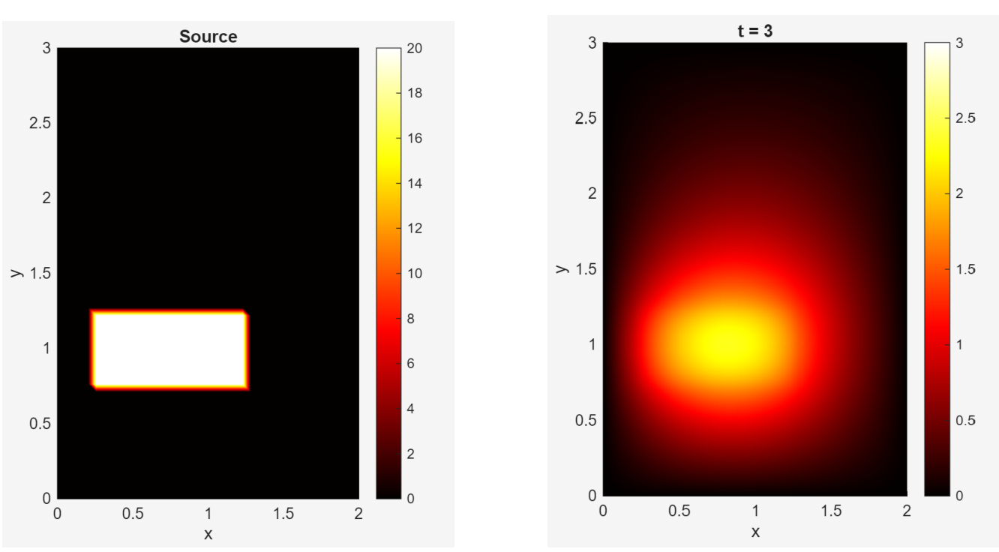
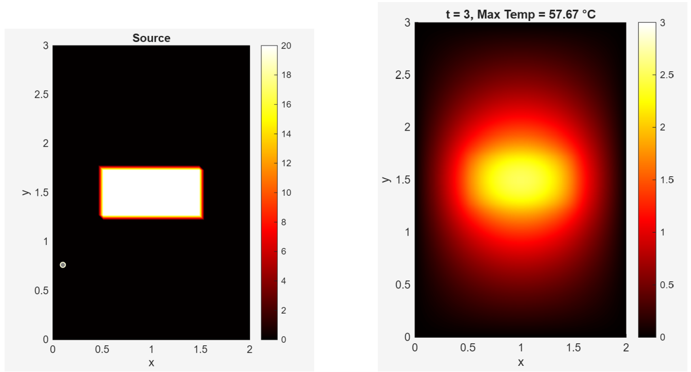
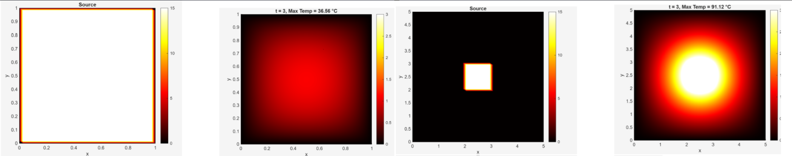

# 2D Transient Heat Equation Solver — CPU & Heat Sink Thermal Design

A MATLAB finite-difference solver for the 2D transient heat equation, used to compare CPU/heat-sink layout configurations by predicted maximum operating temperature.

## Problem

We model heat diffusion on a rectangular plate `R = [0, L_x] × [0, L_y]`, with temperature `u(t, x, y)` governed by:

```
∂u/∂t = ∂²u/∂x² + ∂²u/∂y² + s(x, y)
```

where `s(x, y)` is a localized heat source representing the CPU (constant heat flux over a rectangular region, zero elsewhere), and `u = 0` is enforced at the plate boundary (idealized perfect cooling at the edges).

## Method

- **Spatial discretization:** the domain is discretized on an `Nx × Ny` grid; the Laplacian is approximated at each interior point with a standard 5-point central finite-difference stencil, giving a linear ODE system `du/dt = Au + b`.
- **Boundary conditions:** each boundary grid point is pinned to `u = 0` directly in `A` and `b`.
- **Time integration:** the system is advanced with the **implicit Euler** method, i.e. at each step solving `(I − Δt·A) uⁿ⁺¹ = Δt·b + uⁿ`, which is unconditionally stable for this diffusion problem.

## How to run

```matlab
heat_solver.m
```

Running the script will:
1. Plot the source term `s(x, y)` (CPU position and size).
2. Build the discretized system matrix `A` and vector `b`.
3. Step the solution forward in time with implicit Euler, plotting the temperature field at each step and compiling the frames into a short animation.

Grid resolution, time step, and number of steps are set near the top of the script (`Nx`, `Ny`, `dltt`, `Nt`) and can be adjusted directly.

## Results

**Baseline setup** — CPU in its original (off-center) position:



Three alternative CPU/heat-sink configurations were then compared using maximum steady-state plate temperature as the metric:

| Configuration | Description | Max. temperature |
|---|---|---|
| (a) | Original CPU size, moved to plate center | **57.67 °C** |
| (b) | Larger heat sink (5×5 mm), larger CPU (1×1 mm), centered | 91.12 °C |
| (c) | Heat sink same size as CPU (1×1 mm) — *not physically realistic* | 36.56 °C |





**Configuration (a) is recommended** among the physically realistic options: centering the CPU maximizes distance to all cooled edges, keeping it furthest from the heat concentration a corner or off-center placement would cause.

Configuration (c) achieves the lowest temperature only because the model assumes perfect, instantaneous cooling at the plate's edges — moving the CPU's own edges onto the boundary is an artifact of that idealization, not a valid design choice (see Limitations).

## Limitations

This is a simplified model, with three known gaps between it and a real CPU/heat-sink system:

- **2D approximation.** Heat also moves through the thickness of the CPU and heat sink; a real system is inherently 3D.
- **Idealized boundary cooling.** The model assumes the plate edges remove heat perfectly and instantly. In reality, heat is lost gradually via convection to the surrounding air, and is lost through the *entire* surface — not just the edges. This is precisely why, in practice, a larger heat sink cools better, whereas this model's edge-only cooling makes a larger plate trap more heat (configurations (b) and (c)).
- **Uniform material assumption.** Real CPU/heat-sink assemblies combine materials (silicon, copper, aluminum) with different thermal conductivities, densities, and heat capacities, which this single-material model doesn't capture.

## Acknowledgments

Originally developed as a group project for a Numerical Linear Algebra course assignment. AI assistance was used for LaTeX formatting of the original report (code formatting, figure placement) — not for the modeling, derivation, or code logic itself.
